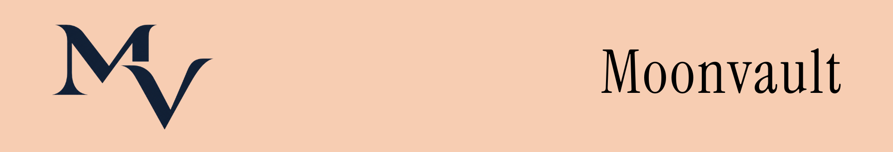
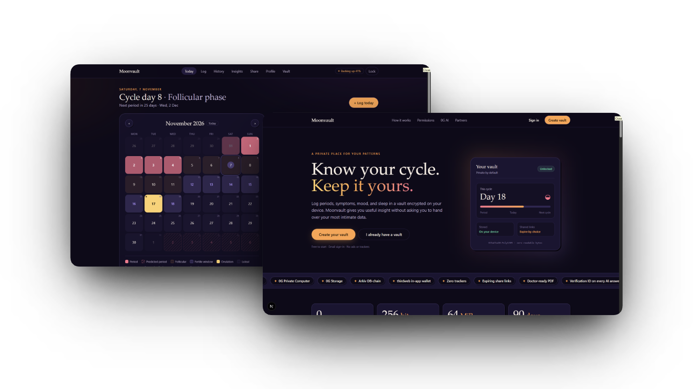
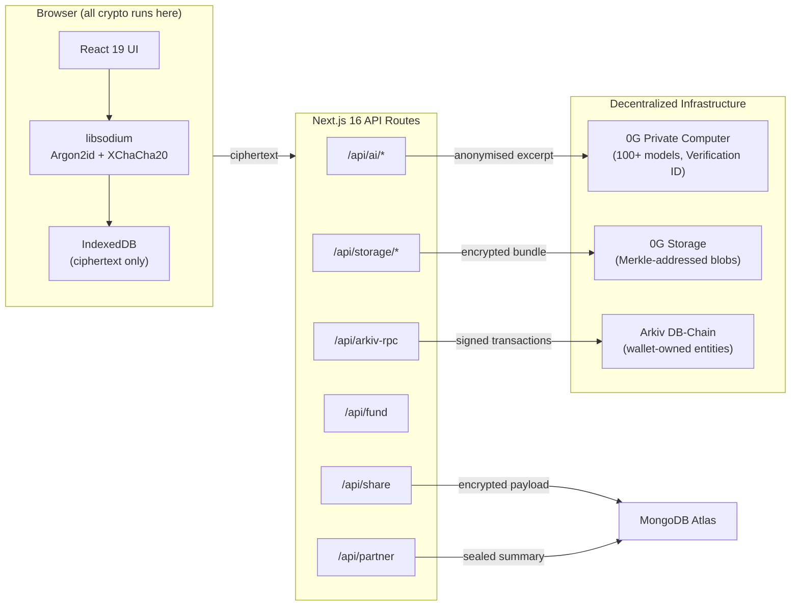

<p align="center">
  
</p>

<p align="center">
  <a href="https://nextjs.org/"></a>
  <a href="https://www.typescriptlang.org/"></a>
  <a href="https://pc.0g.ai/"></a>
  <a href="https://hub.arkiv.network/"></a>
  <a href="https://thirdweb.com/"></a>
  <a href="LICENSE"></a>
</p>

---

### The Problem

Period tracking apps hold some of the most intimate data a person can generate menstrual dates, symptoms, mood, sleep, and free-text notes. Yet the industry norm is cloud-first, ad-funded, and opaque: data is stored in plaintext on third-party servers, sold to data brokers, or subpoenaed by law enforcement. In regions where reproductive data can be weaponised, this isn't a privacy preference  it's a safety concern.

Existing alternatives ask users to choose between **useful AI insights** and **real privacy**. Moonvault refuses that trade-off.

<p align="center">
  
</p>

---

## Overview

**Moonvault** is a private, AI-assisted period tracker where every byte of health data is encrypted in the browser before it goes anywhere. AI runs on **0G Private Computer** with zero data retention. Encrypted backups live on **0G Storage**. Account records and self-expiring share links live on **Arkiv**. There are no analytics, no trackers, and no third-party CDN fonts or scripts.

Built for **ETHGlobal Mumbai 2026** · Prize tracks: [**0G: Build with 0G PC**](https://ethglobal.com/events/mumbai/prizes/0g) · [**Arkiv: Build on Arkiv**](https://ethglobal.com/events/mumbai/prizes/arkiv)

---

## Table of Contents

- [Overview](#overview)
- [Key Features](#key-features)
- [How Privacy Works](#how-privacy-works)
- [System Architecture](#system-architecture)
- [Prize Track Documentation](#prize-track-documentation)
- [Technology Stack](#technology-stack)
- [Repository Layout](#repository-layout)
- [Quick Start](#quick-start)
- [Integration Status](#integration-status)
- [Documentation](#documentation)
- [License](#license)

---

## Key Features

| Feature | Description | Route |
| :--- | :--- | :--- |
| **Email-code login** | thirdweb in-app wallet — no seed phrase, no extension, no blockchain UX | `/signup`, `/unlock` |
| **Vault passphrase** | Argon2id (64 MiB) key derivation, zxcvbn strength check, auto-lock on inactivity | `/signup` |
| **Daily log** | Flow, symptoms, mood, sleep, free-text notes | `/log` |
| **Voice logging** | 45 s audio → 0G PC transcription → structured fields → user confirms | `/log` |
| **Cycle calendar** | Period days, predicted next period, fertile window, ovulation estimate, confidence note | `/calendar` |
| **History & charts** | Cycle length trends, symptom frequency, sleep tracking, full entry table | `/history` |
| **Ask Your Cycle** | Natural language Q&A on personal patterns, each answer returns a **0G Verification ID** | `/ask` |
| **Pattern insights** | Multi-month trend analysis via 0G Private Computer | `/ask` |
| **Doctor summary PDF** | One-page medical summary generated entirely in-browser with jsPDF | `/ask` |
| **Encrypted cloud backup** | Auto-backup to 0G Storage with pending/synced indicators, one-step restore | `/settings`, `/restore` |
| **Shared Access Links** | Scoped + time-limited, link + QR + WhatsApp, active list with countdown, one-tap revoke | `/share` |
| **Doctor view** | No-login read-only report from a shared link — no wallet, no extension | `/s/[id]` |
| **Partner sharing** | Lasting account-to-account link showing cycle phase, next period, and optional mood | `/partner` |
| **Works offline** | Log without signal; encrypted backups catch up when online | — |

---

## How Privacy Works

```
passphrase ──Argon2id──▶ KEK ──wraps──▶ DK (random 32 B, memory only while unlocked)
                                         │
     entries / AI results ──XChaCha20-Poly1305──▶ IndexedDB (ciphertext only)
     full snapshot ──gzip──▶ seal(DK) ──▶ 0G Storage ──root──▶ Arkiv mv.profile
     share package ──gzip──▶ seal(share key) ──▶ Arkiv mv.share (expires) ; key only in URL #fragment
     AI request ──decrypt locally, anonymise (relative days, scrub names/emails/phones)──▶ /api/ai ──▶ 0G PC
```

- The passphrase, KEK, and plain DK are **never written anywhere**. A page reload locks the vault.
- Arkiv records hold only the wrapped key, a backup pointer, random IDs, generic scope labels, timestamps, and ciphertext. See [`arkiv/schema.md`](arkiv/schema.md).
- Secrets (0G API key, Arkiv access key, relay key) are server-side only. The browser talks to `/api/*`.

---

## System Architecture



---

## Prize Track Documentation

Detailed write-ups for each ETHGlobal Mumbai prize track:

| Track | Prize Page | Documentation |
| :--- | :--- | :--- |
| **0G: Build with 0G PC** | [ethglobal.com/events/mumbai/prizes/0g](https://ethglobal.com/events/mumbai/prizes/0g) | [`track/0G.md`](track/0G.md) |
| **Arkiv: Build on Arkiv** | [ethglobal.com/events/mumbai/prizes/arkiv](https://ethglobal.com/events/mumbai/prizes/arkiv) | [`track/ARKIV.md`](track/ARKIV.md) |

See also: [`arkiv/`](arkiv/) for schema, friction log, reach, and why-Arkiv.

---

## Technology Stack

| Layer | Technology |
| :--- | :--- |
| **Framework** | Next.js 16 (App Router, Turbopack), React 19, TypeScript |
| **Styling** | Tailwind CSS 4, system fonts only (no CDN) |
| **Cryptography** | libsodium-wrappers-sumo (Argon2id, XChaCha20-Poly1305) |
| **AI** | 0G Private Computer (OpenAI-compatible router, 100+ models) |
| **Decentralized Storage** | 0G Storage (Merkle-addressed, content-verified) |
| **Database / Records** | Arkiv DB-Chain (@arkiv-network/sdk 1.0.1, Rabdi testnet) |
| **Auth** | thirdweb In-App Wallets (email OTP → self-custodial EOA) |
| **Cloud Database** | MongoDB Atlas (encrypted share/partner/profile fallback store) |
| **Blockchain Tooling** | viem, ethers.js v6 |
| **Charts** | Recharts |
| **PDF** | jsPDF |
| **Compression** | fflate (gzip) |
| **Password Strength** | zxcvbn |
| **Testing** | Vitest 5 (39 tests) |
| **Hosting** | Vercel (bom1 / Mumbai region) |

---

## Repository Layout

```text
.
├── app/                          # Next.js 16 App Router
│   ├── (app)/                    # Authenticated app pages (layout with shell)
│   │   ├── ask/                  # AI Q&A, insights, doctor summary PDF
│   │   ├── calendar/             # Cycle calendar with predictions
│   │   ├── history/              # Charts and entry table
│   │   ├── log/                  # Daily log form + voice logging
│   │   ├── profile/              # User profile
│   │   ├── settings/             # Backup, auto-lock, preferences
│   │   └── share/                # Create/manage shared links + partner card
│   ├── api/                      # Server API routes
│   │   ├── ai/                   # 0G PC proxy (chat, transcribe, speak)
│   │   ├── arkiv-rpc/            # Keyed Arkiv RPC proxy
│   │   ├── fund/                 # Testnet gas relay (tGLM top-up)
│   │   ├── partner/              # Partner link CRUD
│   │   ├── profile/              # Cloud profile store
│   │   ├── share/                # Cloud share store
│   │   └── storage/              # 0G Storage upload/download (ciphertext only)
│   ├── partner/                  # Partner view (read-only, no vault)
│   ├── s/[id]/                   # Doctor view (no-login shared report)
│   ├── signup/                   # Email signup + passphrase creation
│   ├── unlock/                   # Returning user unlock
│   └── restore/                  # Cross-device vault restore
│
├── components/                   # React components
│   ├── landing/                  # Landing page
│   ├── fancy/                    # Animation & motion components
│   └── *.tsx                     # Shared UI components
│
├── lib/                          # Core logic
│   ├── adapters/                 # Service adapters (Arkiv, 0G, mock)
│   │   └── arkiv/                # Arkiv SDK integration (schema, client, adapter)
│   ├── ai/                       # AI prompt builder and input anonymiser
│   ├── auth/                     # thirdweb auth + gas relay
│   ├── backup/                   # Bundle format, auto-backup queue, restore
│   ├── crypto/                   # Envelope encryption, key management, encoding
│   ├── cycle/                    # Cycle math, predictions, date utilities
│   ├── partner/                  # Partner sharing logic
│   ├── server/                   # Server-only: env, rate limiting, db, 0G clients
│   ├── share/                    # Share link creation, reading, revocation
│   ├── vault/                    # IndexedDB vault, records, profile sync
│   └── types.ts                  # Shared type definitions
│
├── arkiv/                        # Arkiv prize track docs
│   ├── schema.md                 # Entity schemas (mv.profile, mv.share)
│   ├── how-you-use-arkiv.md      # Integration walkthrough
│   ├── why-arkiv.md              # Why Arkiv over Postgres
│   ├── reach.md                  # Target audience & growth
│   └── friction.md               # Honest friction log (SDK 1.0.1)
│
├── track/                        # ETHGlobal Mumbai prize track READMEs
│   ├── 0G.md                     # 0G prize track documentation
│   └── ARKIV.md                  # Arkiv prize track documentation
│
├── docs/
│   └── PLAN.md                   # One-page architecture plan
│
├── scripts/                      # Verification scripts
│   ├── verify-arkiv-read.mts     # Live Arkiv read test
│   ├── verify-arkiv-write.mts    # Live Arkiv write test
│   └── verify-zerog.mts          # Live 0G AI + Storage test
│
├── DECISIONS.md                  # Every non-obvious decision with rationale
├── next.config.ts                # Next.js configuration
├── package.json                  # Dependencies and scripts
├── tsconfig.json                 # TypeScript configuration
└── vercel.json                   # Vercel deployment (bom1 / Mumbai)
```

---

## Quick Start

### 1. Clone and Install

```bash
git clone https://github.com/shwet46/Moonvault.git
cd Moonvault
npm install
```

### 2. Demo Mode (no keys needed)

```bash
cp .env.example .env.local
echo "NEXT_PUBLIC_MOCK_SERVICES=true" > .env.local
npm run dev          # http://localhost:3000
```

Login code in demo mode: `123456`

### 3. Run Tests

```bash
npm test             # Vitest: 39 tests (crypto, vault, bundle, share, cycle math)
npm run lint && npm run build
```

### 4. Real Services (all free except 0G PC credits)

| Variable | Get it |
| :--- | :--- |
| `NEXT_PUBLIC_THIRDWEB_CLIENT_ID` | [thirdweb dashboard](https://thirdweb.com/dashboard) (free). Enable **Email** for in-app wallets. |
| `ARKIV_ACCESS_KEY` | [hub.arkiv.network/access-keys](https://hub.arkiv.network/access-keys) (free) |
| `RELAY_PRIVATE_KEY` | Any new key. Fund at [hub.arkiv.network/faucet](https://hub.arkiv.network/faucet) (tGLM) **and** [faucet.0g.ai](https://faucet.0g.ai) (0G Galileo). |
| `ZG_API_KEY` | [pc.0g.ai](https://pc.0g.ai) → Dashboard → API Keys (`sk-…`). Needs a deposit or free credits. |
| `MONGODB_URI` | [MongoDB Atlas](https://www.mongodb.com/atlas) (free tier). Required for deployed share/partner persistence. |

Verify each integration:

```bash
npx tsx --env-file=.env scripts/verify-arkiv-read.mts
npx tsx --env-file=.env scripts/verify-arkiv-write.mts
npx tsx --env-file=.env scripts/verify-zerog.mts ai
npx tsx --env-file=.env scripts/verify-zerog.mts storage
```

Check configuration: `GET /api/health` (booleans only, no secrets exposed).

### 5. Deploy

Deploy to Vercel. `vercel.json` pins functions to `bom1` (Mumbai). Set the same env vars in the project settings.

---

## Integration Status

| Integration | Status |
| :--- | :--- |
| Crypto, vault, cycle math, bundle, share packages | ✅ Unit tested (39 tests) and e2e tested |
| Full app on **mock** adapters | ✅ End-to-end: signup → log → backup → AI → share → doctor view → revoke → restore |
| Arkiv reads (no wallet) | ✅ Verified live on Rabdi |
| Arkiv writes (profile, shares, extend, delete) | ⚠️ Implemented against SDK 1.0.1; live run blocked only on faucet funds |
| 0G Storage upload/download | ⚠️ Implemented (server route, Node SDK); live run blocked only on faucet funds |
| 0G PC chat + request ID | ⚠️ Implemented from the router docs; needs an `sk-` key to run live |
| 0G PC transcription | ⚠️ Whisper fallback to `qwen3.5-omni-flash` audio input |
| thirdweb email login + signing | ⚠️ Implemented (in-app EOA → viem account bridge); needs a client ID |
| MongoDB Atlas persistence | ✅ Shares, partners, profiles, and storage blobs persisted across deployments |

> When a real service isn't configured, its route returns a clear `503`. Results are never faked silently — mock mode is labelled "Demo mode" and mock AI answers are tagged `[Demo]`.

---

## Documentation

| Document | Description |
| :--- | :--- |
| [`DECISIONS.md`](DECISIONS.md) | Every non-obvious decision with rationale + verification log |
| [`docs/PLAN.md`](docs/PLAN.md) | One-page architecture plan |
| [`arkiv/schema.md`](arkiv/schema.md) | Arkiv entity schemas (mv.profile, mv.share) |
| [`arkiv/`](arkiv/) | How we use Arkiv, why Arkiv, reach, friction log |
| [`track/0G.md`](track/0G.md) | 0G prize track: integration details and verification |
| [`track/ARKIV.md`](track/ARKIV.md) | Arkiv prize track: integration details and verification |

---

## License

MIT — see [LICENSE](LICENSE).
